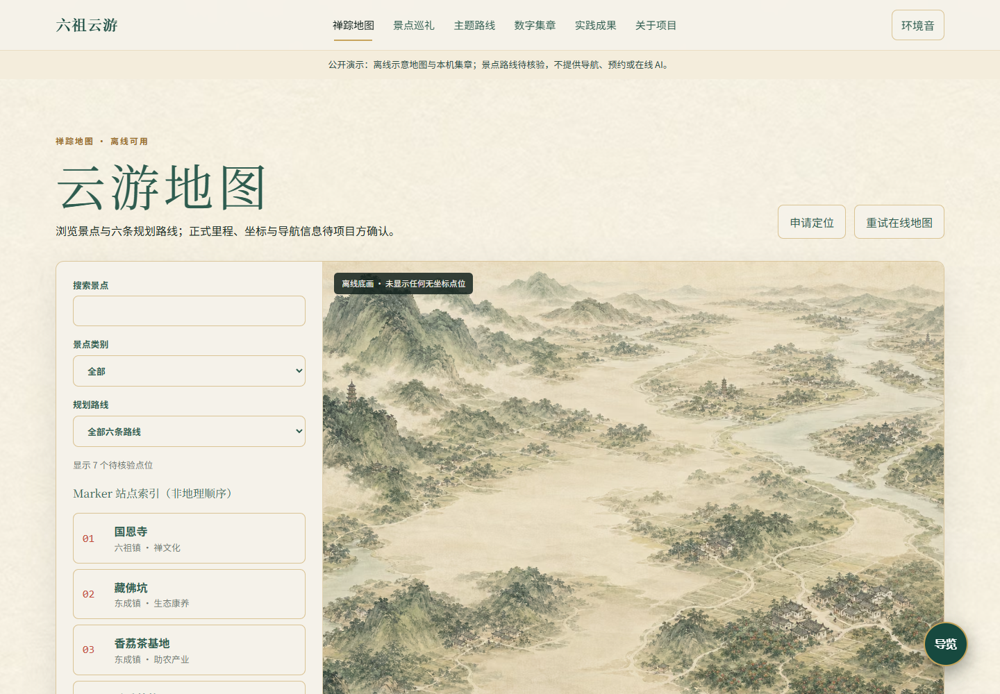
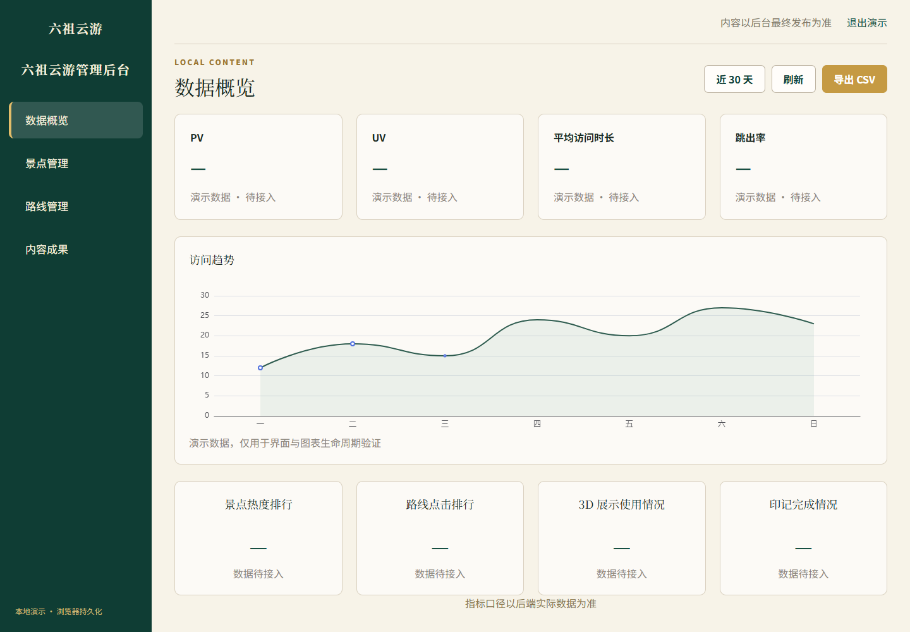

# 六祖云游 · 文化旅游前端演示

将文化故事、景点巡礼、主题路线和旅行集章放进同一套青绿山水界面。这个独立前端工作区同时提供公共站与管理后台，适合学习 React 组件设计、可解释的服务降级、版本化浏览器数据仓储和响应式文旅展示。

**状态：前端演示可运行，真实地图、模型、云端身份与生产数据仍待接入。** 本仓库是 React/Vite 版本；另外的 Next.js“云游地图”与移动端工程属于相关开发分支，不能把它们的身份、数据库和导航功能算成本仓库已上线能力。

[在线演示](https://yangwei251003.github.io/liuzu-cloud-tour/) · [本地后台演示](https://yangwei251003.github.io/liuzu-cloud-tour/admin/) · [素材与许可](THIRD_PARTY_NOTICES.md)


## 可以体验

- 六项内容导航：离线禅踪地图、景点巡礼、主题路线、数字集章、实践成果、关于项目；景点和路线均标注规划或待核验。
- 地图搜索、分类筛选、路线与抽屉；未配置高德时使用标明“非导航地图”的原创 AI 示意底图，不生成貌似精确的经纬度。
- 集章需要页面可见且连续停留 30 秒，4/7 解锁阶段卡片、7/7 解锁纪念证书；进度仅在当前浏览器保存。证书不代表官方认证。
- 三维查看器具备 PLY 接入与明确的失败/重试/图文降级；未提供模型时显示待接入。3DGS 专用渲染器未安装，不宣称支持真实 3DGS 浏览。
- 本地后台可编辑演示景点、路线与成果；任意非空账号和密码进入演示，**没有真实认证，不得填入常用密码或私人数据**，内容不上传服务器。
- 静音山水动效、低动效海报与系统字体回退；公开版使用文字品牌/助手，权利未确认的 Logo、吉祥物、上传视频和原型图不随仓库分发。
- 公开 Pages 的助手只显示静态服务说明，**不会把输入发送给模型**。可选在线模型代理源码单独保留，需要服务端配置。

## 技术栈

Node.js 24、pnpm 10.33.2、TypeScript 6、React 19、Vite 8、React Router 7、Tailwind CSS 4、Motion、Three.js、ECharts、Vitest、Testing Library、Playwright。共享的领域模型、数据仓储与 UI 以 pnpm workspace 连接，锁文件随仓库保存。

## 快速上手

安装 Node.js 24 后，在项目根目录执行：

```sh
npm install --global pnpm@10.33.2
pnpm install --frozen-lockfile
pnpm dev:web
```

打开 `http://localhost:5173/`。另开终端运行 `pnpm dev:admin`，打开 `http://localhost:5174/admin/`。默认不用 API Key、数据库或真实账号。

```sh
pnpm typecheck
pnpm lint
pnpm test
pnpm build
pnpm test:e2e --workers=2
```

浏览器验收使用系统 Chrome，自动启动独立预览端口 17473/17474；先完成 `pnpm build`，无需登录任何服务。生产包本机预览可执行 `pnpm --filter @liuzu/web preview --host 127.0.0.1`（4173）与 `pnpm --filter @liuzu/admin preview --host 127.0.0.1`（4174）。

## GitHub Pages

```sh
pnpm build:pages
```

生成 `pages-dist/`，默认仓库路径为 `/liuzu-cloud-tour/`。更换仓库名时设置 `PAGES_BASE_PATH=/新仓库名/`；工作流根据实际仓库名设置。Pages 构建使用 Hash 路由，支持子页面刷新；公共站与 `/admin/` 都是实际前端。构建产物由 GitHub Actions 保存为部署工件，不提交依赖缓存或 `dist`。

在仓库 Settings → Pages 选择 GitHub Actions，即可使用 [部署工作流](.github/workflows/pages.yml)。Pages **不运行** `api/assistant-chat.js`，不部署地图供应商代理、数据库或云端管理后台。链接仅在工作流部署成功后可用。

## 可选在线服务

仅在自己的可信运行环境中复制 `.env.example` 为 `.env.local`。`ZHIPUAI_API_KEY` 是服务端秘密，禁止加 `VITE_` 前缀或提交 Git；开发代理从工作区根目录读取它，Vercel Functions 模板从平台环境变量读取。无 Key 返回未配置；真实模型请求未纳入公开验证。生产部署前还需补充身份、限流、请求大小、超时、供应商条款与监控，不能把演示代理直接作为开放的公共付费接口。

高德接口保留为可选适配器。浏览器可见的 Key 需限定域名；安全码不要注入公开构建，应按供应商要求配置安全代理。不要把个人定位、真实轨迹、地图密钥、私有模型链接或游客资料写入演示数据。当前模型与景点精确坐标留空，公众文化背景来源见 [事实来源](docs/fact-sources.md)。

## 目录

```text
apps/web/       公共站、地图/集章/查看器与助手
apps/admin/     仅当前浏览器保存的演示后台
packages/domain/ 领域模型、演示数据、版本化仓储
packages/ui/    共享壳、组件、主题
api/            可选服务端模型代理模板
media/hero-motion/ 原创动效源时间线
scripts/        静态打包与公开预览校验
tests/         单元测试基础与真实浏览器测试
```




截图由脱敏副本实际运行产生，AI 山水仅是界面中的示意插画；未使用原型整页图冒充成品。

## 验证与后续

本次公开整理的实际验证结果见 [发布验证记录](docs/release-validation.md)，更新见 [CHANGELOG](CHANGELOG.md)。下一阶段需取得真实景点/路线的官方核验、合法模型与品牌素材授权，并独立实现生产身份和云端仓储。严格像素复刻、全量无障碍合规、性能指标与真实服务端联调尚未通过；历史任务记录不代表生产放行。

## 开源范围

自有代码和文档采用 [MIT](LICENSE)；依赖与已确认生成素材的边界见 [第三方与素材声明](THIRD_PARTY_NOTICES.md)。不包含依赖目录、私有环境文件、游客数据、未知授权照片/字体/模型或原型参考图。原本地目录仍含未公开材料与配置，不能仅凭本仓库已上传就整目录删除。
